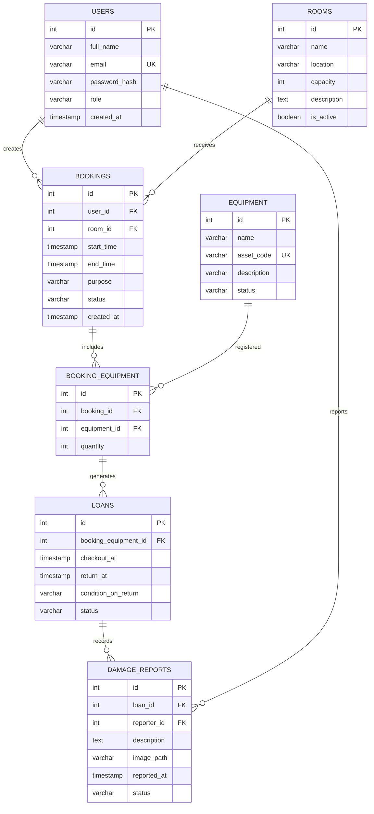

# ERD - Lab Booking System

## 1. Sơ đồ cơ sở dữ liệu

## 2. Mô tả quan hệ

- Một người dùng có thể tạo nhiều yêu cầu đặt lịch.
- Một phòng có thể xuất hiện trong nhiều yêu cầu đặt lịch.
- Một yêu cầu đặt lịch có thể đăng ký nhiều thiết bị.
- Một thiết bị có thể xuất hiện trong nhiều yêu cầu đặt lịch.
- Một mục thiết bị trong yêu cầu đặt lịch có thể phát sinh nhiều lần mượn/trả.
- Một lần mượn/trả có thể có nhiều báo cáo hư hỏng.
- Một người dùng có thể lập nhiều báo cáo hư hỏng.

## 3. Quy tắc dữ liệu

- Email người dùng phải duy nhất.
- Mã tài sản thiết bị phải duy nhất.
- Thời gian kết thúc phải sau thời gian bắt đầu.
- Số lượng thiết bị phải lớn hơn 0.
- Chỉ yêu cầu được duyệt mới được mượn thiết bị.
- Không cho phép hai lịch đặt cùng phòng bị chồng lấn thời gian.

## 4. Các bảng trong hệ thống

| STT | Tên bảng | Chức năng |
|---|---|---|
| 1 | USERS | Lưu thông tin người dùng và vai trò |
| 2 | ROOMS | Quản lý phòng thực hành |
| 3 | EQUIPMENT | Quản lý thiết bị |
| 4 | BOOKINGS | Lưu yêu cầu đặt phòng |
| 5 | BOOKING_EQUIPMENT | Lưu thiết bị được đăng ký trong từng yêu cầu |
| 6 | LOANS | Quản lý quá trình mượn và trả thiết bị |
| 7 | DAMAGE_REPORTS | Lưu báo cáo thiết bị hư hỏng |

## 5. Kết luận

Cơ sở dữ liệu Lab Booking System gồm 7 bảng chính, hỗ trợ quản lý người dùng, phòng thực hành, thiết bị, yêu cầu đặt lịch, mượn trả và báo cáo hư hỏng.

Thiết kế sử dụng khóa chính (PK), khóa ngoại (FK), quan hệ một-nhiều (1:N) và bảng trung gian để quản lý quan hệ nhiều-nhiều (N:N) giữa yêu cầu đặt lịch và thiết bị.